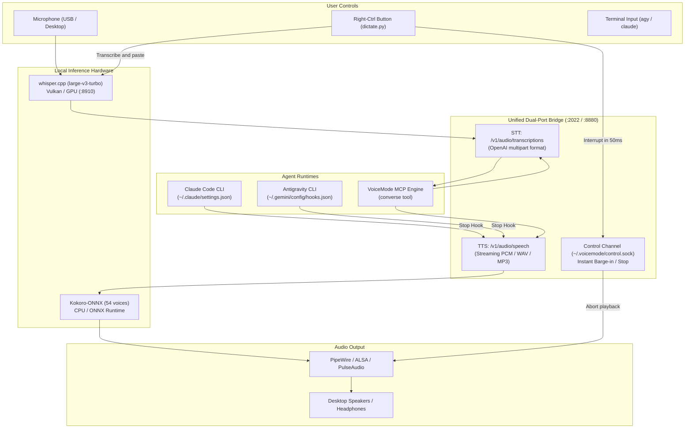

# Local STT / TTS Voice Engine for Claude Code & Antigravity (AGY)

> High-performance, fully local voice interaction, push-to-talk dictation, spoken task summaries, and instant barge-in for **Claude Code (`claude`)** and **Google Antigravity (`agy`)**.

Powered by:
- **Speech-to-Text (STT)**: `whisper.cpp` running `large-v3-turbo` with sub-0.5s latency (accelerated via Vulkan on an Intel Arc B580 GPU / XPU, or any GPU/CPU).
- **Text-to-Speech (TTS)**: `kokoro-onnx` (54 natural voices) with sub-second time-to-first-audio (TTFA ~0.4s).
- **Push-to-Talk & Interruption**: Global keyboard listener (`KEY_RIGHTCTRL` / `evdev`) delivering instant dictation injection and sub-50ms TTS interruption.
- **Agent Lifecycle Hooks**: Silences intermediate tool runs and reads a clean spoken summary aloud when tasks finish.
- **In-Session Mode Switching**: Switch between **Conversation Mode** (`/talk`) and **Coding Mode** (`/code`) in the same terminal with 100% shared context.

---

## 🏛️ Architecture



---

## ✨ Key Features

### 1. Unified Dual-Port Voice Bridge (`server.py`)
Provides OpenAI-compatible endpoints on both standard VoiceMode ports:
- **Port 2022**: Whisper STT endpoint (`/v1/audio/transcriptions`), bridging requests to the resident `whisper.cpp` server.
- **Port 8880**: Kokoro TTS endpoint (`/v1/audio/speech`), delivering low-latency audio generation.
- Both ports handle health checks (`/health`) and failover.

### 2. Spoken Task Completion Summaries
During complex code building, refactoring, and test runs:
- Intermediate tool use (`Bash`, `read_file`, `edit_file`) remains **completely silent** (no annoying repetitive tool beeps).
- When the execution loop finishes, the `Stop` lifecycle hook triggers `voicemode-speak-summary.py`.
- It automatically parses the session transcript (Claude JSONL or AGY JSONL), strips code blocks and Markdown markup into speakable text, and reads the outcome aloud via Kokoro TTS.

### 3. Fast Mode Switch: Quiet Chime vs. Spoken TTS
Toggle between spoken summaries and quiet completion chimes anytime:
```bash
voicemode-summary on       # Kokoro reads final summaries aloud
voicemode-summary off      # Quiet mode: single completion chime only
voicemode-summary toggle   # Toggle between voice and chime
voicemode-summary status   # View current state
```

### 4. Deterministic Barge-in & Interruption
Stop long-winded speech immediately through multiple interfaces:
- **Push-to-Talk Button (`KEY_RIGHTCTRL`)**: Pressing your dictation key aborts active TTS playback in under **50ms** via the control socket.
- **Acoustic Voice Barge-in**: Enabled for all audio devices (`VOICEMODE_MOUTH_BARGE_DEVICES=.*`).
- **CLI / Shortcut**: Run `voicemode-stop` or `voicemode control stop` to silence audio instantly.

### 5. In-Session Mode Switching with 100% Shared Context
No need to run separate terminals for chat and coding:
- **Conversation Mode (`talk` / `/talk`)**: Enters an interactive, hands-free verbal loop. Whisper listens, Kokoro answers, and the mic remains open for your reply.
- **Coding Mode (`code` / `/code`)**: Ends the voice loop and immediately begins hands-on coding using the **exact conversation context** from your discussion.

---

## 🛠️ Repository Layout

```text
claude_STT_TTS/
├── README.md                      # This guide
├── LICENSE                        # MIT License
├── install.sh                     # One-click installer & configurator
├── bridge/
│   ├── server.py                  # Dual-port FastAPI bridge (:2022, :8880)
│   ├── test_bridge.py             # Latency & endpoint test suite
│   ├── start.sh                   # Manual bridge starter
│   ├── stop.sh                    # Manual bridge stopper
│   └── systemd/
│       ├── claude-voice-bridge.service
│       ├── whisper-server.service
│       └── dictate.service
├── hooks/
│   ├── voicemode-speak-summary.py # Transcript parser & summary speaker
│   ├── voicemode-hook-receiver.sh # Fast PipeWire-aware hook receiver
│   ├── voicemode-summary          # Summary toggle CLI
│   └── voicemode-stop             # Instant barge-in stop CLI
└── config/
    ├── voicemode.env.template     # VoiceMode configuration template
    ├── agy/
    │   ├── hooks.json             # AGY Stop hook configuration
    │   ├── mcp_config.json        # AGY VoiceMode MCP registration
    │   └── skills/                # AGY skills: talk, code, voicemode
    ├── claude/
    │   ├── commands/              # Claude slash commands (/talk, /code)
    │   └── skills/                # Claude skills: talk, code, voicemode
    └── dictate/
        ├── dictate.py             # evdev push-to-talk daemon with barge-in
        └── dictate.toml.example   # Configuration for audio & hotkeys
```

---

## 🚀 Quick Start (Automated Installation)

Clone this repository and run the installer:

```bash
git clone https://github.com/<your-username>/claude-agy-voice-engine.git
cd claude-agy-voice-engine
./install.sh
```

The installer will:
1. Place hooks and CLI commands into `~/.local/bin` and `~/.voicemode/bin`.
2. Configure `~/.voicemode/voicemode.env` with local endpoints and control channels.
3. Install skills and hooks for **Antigravity** (`~/.gemini/config`) and **Claude Code** (`~/.claude`).
4. Register user systemd services for continuous background operation.

---

## ⚙️ Hardware & Environment Setup

This configuration was built and tested on **Ubuntu Linux (x86_64)** with an **Intel Arc B580 GPU (XPU)** using Vulkan for Whisper and ONNX Runtime for Kokoro. It can be easily adapted to any GPU or CPU setup.

### 1. Whisper Backend (`whisper.cpp`)
- Build `whisper-server` with your preferred backend:
  - **Intel Arc (Vulkan)**: `cmake -B build -DGGML_VULKAN=1 && cmake --build build --config Release -j`
  - **NVIDIA (CUDA)**: `cmake -B build -DGGML_CUDA=1 && cmake --build build --config Release -j`
  - **CPU**: `cmake -B build && cmake --build build --config Release -j`
- Download the model:
  ```bash
  wget -P /path/to/models/ https://huggingface.co/ggerganov/whisper.cpp/resolve/main/ggml-large-v3-turbo-q8_0.bin
  ```

### 2. Kokoro TTS Backend
Install `kokoro-onnx` and download model weights:
```bash
pip install kokoro-onnx soundfile fastapi uvicorn httpx
wget -P /path/to/models/ https://github.com/thewh1teagle/kokoro-onnx/releases/download/model-files-v1.0/kokoro-v1.0.onnx
wget -P /path/to/models/ https://github.com/thewh1teagle/kokoro-onnx/releases/download/model-files-v1.0/voices-v1.0.bin
```

### 3. Environment Variables (Customizing Paths)
You can configure custom model locations in `server.py` via environment variables:
```bash
export WHISPER_URL="http://127.0.0.1:8910/inference"
export KOKORO_MODEL_PATH="/path/to/kokoro-v1.0.onnx"
export KOKORO_VOICES_PATH="/path/to/voices-v1.0.bin"
```

---

## 🎮 Everyday Usage

### In Antigravity (`agy`):
- Type **`talk`** or **`talk to me`** ➔ Enters continuous hands-free voice mode.
- Type **`code`** or **`let's code`** ➔ Exits voice and starts coding with the shared context.
- Hold **Right-Ctrl** ➔ Dictate prompts directly at the cursor.

### In Claude Code (`claude`):
- Type **`/talk`** ➔ Enters continuous hands-free voice mode.
- Type **`/code`** ➔ Switches to coding mode.
- Hold **Right-Ctrl** ➔ Dictate prompts directly at the cursor.

### Controlling Audio & Summaries:
```bash
# Check service status
uvx voice-mode status

# Mute spoken summary (use quiet completion chime only)
voicemode-summary off

# Re-enable spoken summary
voicemode-summary on

# Instant interruption
voicemode-stop
```

---

## 📦 Publishing to GitHub

To publish this as an open-source project:

```bash
cd /home/guido/claude_STT_TTS
git init
git add .
git commit -m "feat: initial release of local voice engine for Claude Code and Antigravity"
git branch -M main

# Add your GitHub remote repository:
git remote add origin git@github.com:<your-username>/claude-agy-voice-engine.git
git push -u origin main
```

---

## 📄 License

MIT License. See [LICENSE](LICENSE) for details.
